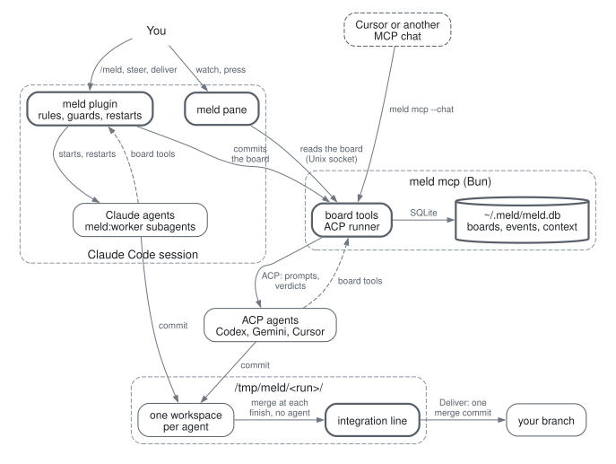

# meld

Give one request to several coding agents. Watch their commits in a pane. Get one commit that passed your checks.

<p align="center">
<picture>
  <source media="(prefers-color-scheme: dark)" srcset="docs/images/working-dark.png">
  
</picture>
</p>

- **Each agent works in its own workspace,** a jj workspace or a git worktree. Your branch does not change until you deliver.
- **The agents plan the request** as tasks on a shared board, and share what they learn.
- **meld merges each finished task** into one integration line. One agent then checks the line and declares the final commit.
- **You steer with one press,** and deliver the result as one merge commit.

meld is a Claude Code plugin in TypeScript, with no native binary. Claude, Codex, Gemini and Cursor agents can work in one run.

## Why several agents

One coding agent works through a request one step at a time. You wait for each step, and you check and answer each one. Several agents on one shared board change three things:

- **Shorter iterations.** Agents work on independent tasks at the same time, so a request gets to a tested commit sooner. Each finished task merges into the line at once, so a conflict shows while it is small.
- **Less feedback fatigue.** You review one result with its checks, not each step of each agent. When the direction is wrong, one instruction steers all the agents.
- **More tokens, used well.** Each agent spends its tokens on its own task, in a small context. meld caps each context and sends each agent only the entries that are new for it. So more tokens buy more work, not repeated reads.

The speedup has a limit. The part of a request that must happen in order, such as the last task and the final check, sets the upper bound (Amdahl's law).

meld takes its idea from [DeLM](https://github.com/Decentralized-LM/delm-agent-plugin) (Decentralized Language Models, by Yuzhen Mao and Azalia Mirhoseini, MIT license): a task queue and a shared context, with no planner in charge. In the DeLM paper, the main agent of Claude Code waited for its subagents 73% of the time on one long task. DeLM removes that wait. meld is a new tool, not a port, and [docs/how-it-works.md](docs/how-it-works.md#what-meld-changes-from-delm) lists the changes.

[The design notes](docs/meld-design.html) give the background in one page: DeLM, the task queue and the shared context, the workspaces, how you see a run, and a local run in detail.

## Install

In Claude Code:

```
/plugin install meld --marketplace bhi5hmaraj/meld
```

From a shell, run `claude plugin install meld --marketplace bhi5hmaraj/meld`. In the desktop app, click **+** next to the prompt box, then **Plugins**, **Add marketplace**, `bhi5hmaraj/meld` and **Add plugin**.

- **git 2.38 or newer** is necessary. The integration line merges with `git merge-tree --write-tree`, also for jj. With an older git, meld refuses to start a run.
- **jj 0.40 or newer** is optional. With jj, each agent gets a jj workspace, and without it a git worktree.
- **[Bun](https://bun.sh)** is optional. With Bun, each run lives in `~/.meld/meld.db`, and `/meld-resume` takes the run of a session that ended. Without Bun, a run ends with its session.
- **Node and a login of the vendor** are necessary for Codex, Gemini and Cursor agents. These agents also need Bun.

Tested with Claude Code 2.1.317 to 2.1.319, git 2.43, jj 0.46 and Bun 1.4.4, on Linux and macOS.

## Start a run

```
/meld --agents 3 Add a dark theme with a toggle in the header
```

Or open the pane with `/meld-status` and fill in its start form. Or ask Claude: "start a meld run with 3 agents to add a dark theme".

<picture>
  <source media="(prefers-color-scheme: dark)" srcset="docs/images/start-dark.png">
  
</picture>

Options come before the request, in any order:

| Option | Effect |
|---|---|
| `--agents 3` | Starts 3 agents. A run has 1 to 8, and 2 by default. |
| `--agents opus,general-purpose@haiku` | Starts one agent for each item: a model, an agent type, or `type@model`. |
| `--agents opus,codex` | Mixes vendors: `codex`, `gemini`, `cursor`, or `acp:<name>` of `MELD_ACP_AGENTS`. |
| `--model sonnet` | Sets the model of each agent that names none. |
| `--vcs git` | Makes git worktrees. `jj` makes jj workspaces, and `auto`, the default, uses jj when it is installed. |
| `/path/to/repo` | Starts the run in another repository. |

## Commands

| Command | Effect |
|---|---|
| `/meld <request>` | Starts a run. |
| `/meld-status` | Opens the pane. |
| `/meld-steer <instruction>` | Gives every agent a new instruction. |
| `/meld-add [agent]` | Adds an agent to a run at work. |
| `/meld-stop` | Stops every agent. The workspaces stay. |
| `/meld-deliver` | Merges the final commit into your branch. |
| `/meld-discard` | Removes the run and its workspaces. |
| `/meld-report [id \| --runs]` | Gives the report of the run, of an archived run, or a table of the archived runs. |
| `/meld-resume [board]` | Lists or takes the runs of other sessions. Needs Bun. |
| `/meld-clean [id ...]` | Lists or removes the folders that other runs left in `/tmp/meld/`. |

Claude has a tool for each command, so it can drive a run where no pane shows, for example in a cloud session. What you type in the chat goes to Claude, not to the agents.

## The pane

While the agents work, the pane shows, from the top:

- **Header:** the state, the agents, the time and the dollars of the run, the request, a count of the tasks such as `9 of 14 tasks done, 3 working, 1 ready`, and one bar. **Stop all** stops the run.
- **Agents:** a card for each agent with its task, what it does now in its own words, and the titles of the tasks it finished. An idle agent with a ready task shows **Start**.
- **Conversation:** the notes of the agents, the handovers from one agent to another, your steers, and the merges and conflicts of meld, oldest first.
- **Learnings:** the facts, the fails to avoid and the contracts that the agents shared, with who shared each one and who used it.
- **Plan:** the tasks as a tree, with a word on each: who works on it, how long it is ready, `waits for #N`, or done.
- **Steer:** an instruction in your words, or a preset: **+ Tests**, **Smaller**, **Fix checks** or **Integrate now**.

The pane makes no model call. Each line comes from the board and from version control, and the terminal shows the same facts in characters.

## Deliver

When every task is in the integration line, one agent runs the final build and the checks, and declares the final commit.

<picture>
  <source media="(prefers-color-scheme: dark)" srcset="docs/images/ready-dark.png">
  
</picture>

The report then takes the place of the agents, the conversation, the learnings and the plan:

- **Final commit:** its files and its checks.
- **Story:** what the run did, in a few sentences that meld fills from its metrics.
- **What each agent did:** the titles of its finished tasks, and how many learnings it shared and used.
- **Timeline:** one lane for each agent over the whole run, and three numbers: the agents at work on average, the share of the time one agent worked alone, and the cost per task.

The final commit has four buttons:

- **Deliver** (`d`) merges the final commit into your branch as one merge commit, and removes the workspaces. Your checkout must be clean.
- **Show diff** (`v`) opens the diff.
- **Ask for changes** opens the steer box: your instruction goes to the agents, and they change the result.
- **Discard** removes the workspaces with no merge.

Before meld removes a run, it writes the record of the run and its report to `~/.meld/archive/<run>.json`. `/meld-report` gives the report as text. A stopped run keeps its workspaces until you deliver or discard it.

## Lead a run from Cursor

`meld mcp --chat` gives a chat that speaks MCP the tools of the main session. Its agents are ACP agents. Clone meld, and add it to `.cursor/mcp.json`:

```json
{ "mcpServers": { "meld": { "command": "bun", "args": ["/path/to/meld/mcp/main.ts", "--chat"] } } }
```

Then ask the chat: "start a meld run with 2 codex agents to add a dark theme". This mode has no live check with Cursor yet.

## How it works

<p align="center">
<picture>
  <source media="(prefers-color-scheme: dark)" srcset="docs/images/architecture-dark.svg">
  
</picture>
</p>

A thick border marks the parts of meld, and a dashed arrow a call of the board tools. Graphviz draws the picture from [docs/images/architecture.dot](docs/images/architecture.dot).

1. **Workspaces:** meld makes one workspace for each agent from `HEAD`, under `/tmp/meld/<run>/`.
2. **Plan:** the agents plan the request as small tasks on the board. The first plan wins.
3. **Work:** each agent claims a task, commits in its workspace, and hands back with one line.
4. **Share:** the agents share facts, fails and interfaces. Each board read gives an agent only the entries that are new for it.
5. **Integrate:** at each finished task, meld merges its commit into the integration line, with no agent. A conflict becomes a task `integrate #N`.
6. **Finish:** when every task is done, one agent builds the line, runs the checks, and declares the final commit.

[docs/how-it-works.md](docs/how-it-works.md) gives the details: the board, the guards, restarts and compaction, jj and git, and the integration line.

## Limits

- **1 to 8 agents, and one run at a time.**
- **Your last commit is the base.** Commit the changes that the agents need before the run.
- **No dependencies in the workspaces.** The agents install them when their checks need them.
- **A guard rail, not a sandbox.** meld refuses an edit tool outside the workspace of an agent, but a Bash command can write in other folders.
- **Restarts wait for your session.** An idle agent starts again at the end of a turn of your session ([#12](https://github.com/bhi5hmaraj/meld/issues/12)).
- **More agents cost more.** The header shows the dollars of the run.
- **An early access API.** The plugin API of Claude Code can change between releases.

## More

- [CHANGELOG.md](CHANGELOG.md) gives the changes of each release.
- [docs/development.md](docs/development.md) maps the code, the tests and the checks.
- [docs/meld-design.html](docs/meld-design.html) gives the design notes in one page.
- [docs/design](docs/design/README.md) holds the draft design notes by topic, and the build plan.
- [The handover of 5 November 2026](docs/handover-2026-11-05.md) gives the state, the open work and the traps, for a new maintainer.

## License

MIT
