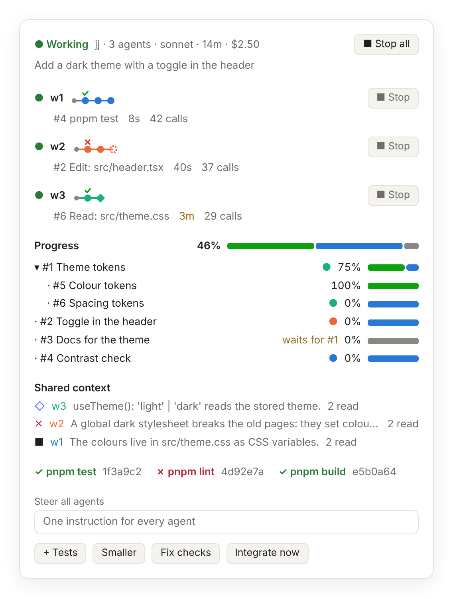
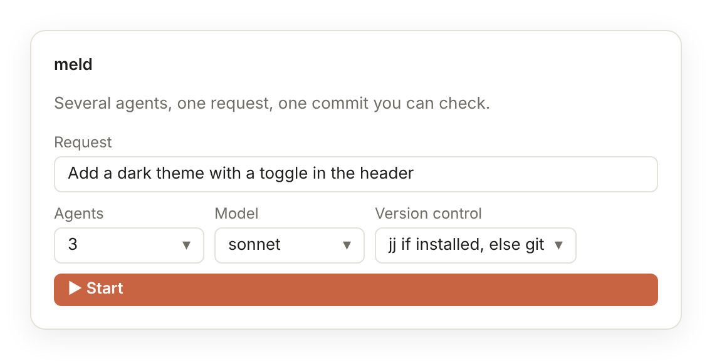
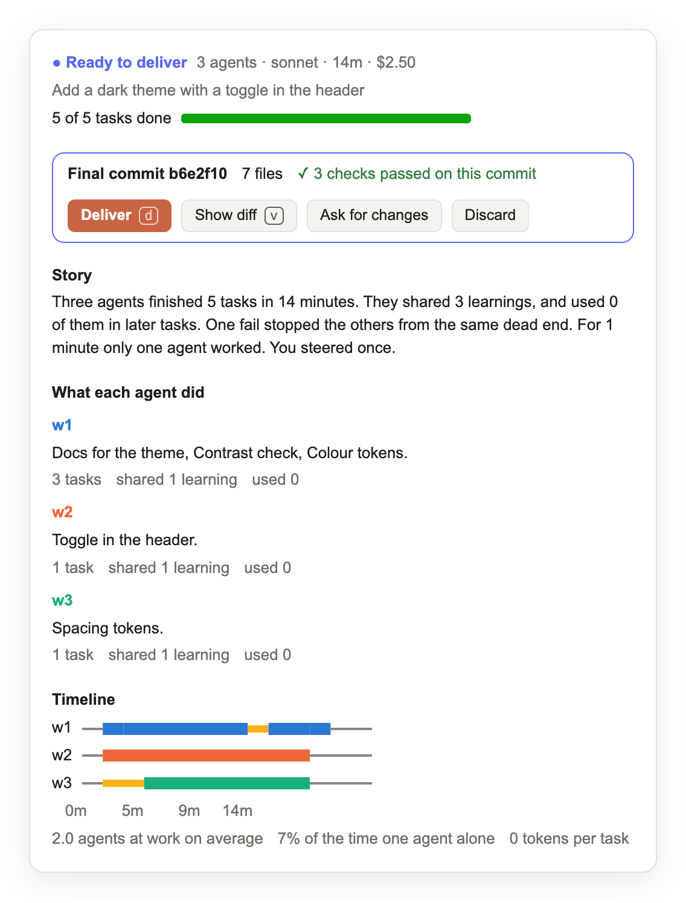

# meld

Give one request to several Claude Code agents. Watch their real commits in a pane. Get one commit that passed your checks.

Each agent works in its own jj workspace or git worktree. The agents plan the request as tasks on a shared board and share what they learn. meld merges each finished task into one integration line, and one agent checks the line and declares the final commit. You steer with one press, and nothing touches your branch until you deliver.

<p align="center">
<picture>
  <source media="(prefers-color-scheme: dark)" srcset="docs/images/working-dark.png">
  
</picture>
</p>

meld is a Claude Code plugin: one hooks module in TypeScript, with no native binary.

## Install

At the prompt of Claude Code in a terminal:

```
/plugin install meld --marketplace bhi5hmaraj/meld
```

From a shell: `claude plugin install meld --marketplace bhi5hmaraj/meld`.

In the desktop app, click **+** next to the prompt box, and click **Plugins**. Click **Add marketplace**, type `bhi5hmaraj/meld`, and click **Add plugin**.

meld needs git 2.38 or newer, because the integration line merges with `git merge-tree --write-tree`, also for jj. With an older git, meld refuses to start a run and names the version of your git. meld uses jj 0.40 or newer when jj is installed. It was tested with Claude Code 2.1.317, jj 0.46 and git 2.43 on Linux.

With [Bun](https://bun.sh) installed, meld keeps each run in the SQLite file `~/.meld/meld.db`, through `meld mcp`, an MCP server that the plugin starts with the session. All sessions on the machine use that file, and `/meld-resume` takes a run of a session that ended. Without Bun, `meld mcp` does not start, and a run lives in the state of its session, as in meld 0.8. It was tested with Bun 1.4.4.

## Start a run

Type the request after `/meld`:

```
/meld --agents 3 Add a dark theme with a toggle in the header
```

Or fill in the start form of the pane, which `/meld-status` opens. Or ask Claude in the chat, for example "start a meld run with 3 agents to add a dark theme".

<picture>
  <source media="(prefers-color-scheme: dark)" srcset="docs/images/start-dark.png">
  
</picture>

| Command | What it does |
| --- | --- |
| `/meld <request>` | Starts 2 agents on the request, from the last commit of your repository. |
| `/meld --agents 3 <request>` | Starts 3 agents. A run has 1 to 8 agents. |
| `/meld --agents opus,general-purpose@haiku <request>` | Starts one agent for each item: a model, an agent type, or a type and a model with `@` between them. |
| `/meld --model sonnet <request>` | Starts each agent that names no model on `sonnet`. |
| `/meld --agents opus,codex <request>` | Starts a Claude agent and a Codex agent. `meld mcp` runs Codex through ACP with `npx -y @agentclientprotocol/codex-acp`, which needs Node and an OpenAI login. Needs Bun. |
| `/meld --agents gemini,cursor <request>` | Starts the Gemini CLI (`npx -y @google/gemini-cli --acp`) and the agent of Cursor (`agent acp`) through ACP. Each needs its own login. Not checked live yet. |
| `/meld --agents acp:<name> <request>` | Starts the ACP agent that `MELD_ACP_AGENTS` names. Set it in the environment of Claude Code to a JSON object from a name to its command, for example `{"mine":["node","/path/to/agent.js"]}`. A name of the table, such as `codex`, gets the command that you give. |
| `/meld --vcs git <request>` | Makes git worktrees. `--vcs jj` makes jj workspaces. `--vcs auto`, the default, uses jj when jj is installed. |
| `/meld /path/to/repo <request>` | Starts the run in another repository. |
| `/meld-steer <instruction>` | Sends a new instruction to every agent. |
| `/meld-status` | Opens the pane. |
| `/meld-stop` | Stops every agent. The workspaces stay for review. |
| `/meld-clean` | Lists the folders that other runs left under `/tmp/meld/`: the id, the state, the age and the size of each, and the work in its workspaces. |
| `/meld-clean <id> ...` | Removes those folders with their workspaces and any work in them, as Discard does. `--all` removes only the folders that hold no work and that no run can use. It keeps the others and tells why. |
| `/meld-resume` | Lists the runs of other sessions on this machine, from `~/.meld/meld.db`. Needs Bun. |
| `/meld-resume <board>` | This session takes that run, 60 s or more after the last write of its session, and starts its idle agents again. |

The options come before the request, in any order. Each agent starts as the hidden agent type `meld:worker`, in its own folder. With no `--model`, an agent uses the model of its agent type, and `meld:worker` uses the model of your session.

## Watch and steer

The picture at the top of this page shows a run at work. meld reads the commits and the diff from version control every 3 seconds.

- **Header** shows the state, the version control, the agents and the time since the start. It shows the dollars that your session spent since the run started. **Stop all** stops the run.
- **Lanes** show the real commits of each agent since the base, oldest first. ◆ is a merge, ★ the final commit, ✕ a conflict, and a dashed ring the edits that the agent did not commit. A green check or a red cross above a commit shows a check that passed or failed on it.
- **Activity** under each lane shows the claimed task, the last action, the time since that action, and the tool calls. The time turns yellow after 2 minutes with no tool call, and red after 5 minutes. **Stop** stops one agent and opens its tasks for the other agents.
- **Progress** shows the percent of the request, and one row for each task. A row shows the percent of the task, a bar of its done, claimed and open parts, and a dot for each agent on it. `waits for #N` shows while a task that it needs is not done. A press on a row with parts opens the parts.
- **Shared context** shows the five newest entries that the agents shared: ■ a fact, ✕ a fail, ◇ an interface. Each entry shows the number of agents that read it.
- **Checks** show the last result of each check command, with its commit.
- **Steer** takes an instruction in your words, and four presets: **+ Tests**, **Smaller**, **Fix checks** and **Integrate now**.

What you type in the chat goes to Claude, not to the agents. To steer the agents, use the pane or `/meld-steer`, or ask Claude to steer them. The mobile app has no text field, so send `/meld-steer` and the instruction. The terminal draws the lanes and the bars in characters.

## Control a run without the pane

Some places show no meld pane, for example a cloud session in the Claude app. Each action of the pane has a command, and Claude has a tool for each one. Ask Claude, or send the command.

| Command | Tool | What it does |
|---|---|---|
| `/meld-steer <instruction>` | `steer` | Gives every agent the instruction. |
| `/meld-stop` | `stop` | Stops every agent. The workspaces stay. |
| `/meld-deliver` | `deliver` | Merges the final commit into your branch, and removes the workspaces. |
| `/meld-discard` | `discard` | Stops the run, and removes its workspaces with their commits. |
| `/meld-add [agent]` | `add_worker` | Adds an agent to a run at work. |

Only the main session uses these tools. An agent of the run that calls one gets `NOT_ALLOWED`.

**A new agent.** `/meld-add` adds one agent to a run that starts or works, up to 8 agents. Its workspace starts from the head of the integration line, so it has the finished work, or from the base when no task finished. The agent starts at once and reads the board. Name its model or type as `/meld --agents` does: `opus`, `Explore`, or `general-purpose@haiku`. With no name, it takes the agent of w1. When the run gets its final commit while the agent starts, meld does not bind the agent to the new worker: the worker shows as not started, so the run does not wait for it.

## Deliver the result

When the integration line holds every task, one agent runs one final build and the checks on it, and declares the final commit. Then the run is ready.

<picture>
  <source media="(prefers-color-scheme: dark)" srcset="docs/images/ready-dark.png">
  
</picture>

The result card shows the final commit, the changed files, the lines added and removed, and the checks that ran on that commit. A warning shows when no check ran on it.

- **Deliver** (`d`) merges the final commit into your branch with a merge commit, and removes the workspaces. Your checkout must have no uncommitted changes. If the merge stops, meld aborts it, and nothing changes. Deliver refuses a final commit that lacks the commit of a task that is done on the board: the reply names the tasks, and you steer the run so that an agent merges them. The subject of the merge commit is `meld: ` and the summary of the final commit, cut at a space to 72 characters at most. With no summary, it is the first line of the request. The body holds the full request.
- **Show diff** (`v`) opens the diff of the first eight files.
- **Ask for changes** gives the agents your instruction, and they change the result. meld first moves the integration line to the final commit, so that the next final commit keeps its work.
- **Discard** removes the workspaces with no merge. **Clear** removes a delivered run from the pane.

**Old runs.** A stopped run keeps its workspaces until you deliver or discard it. A new start removes them when they hold no work, as after a start that started no agent. When they hold commits or uncommitted edits, or meld cannot read them, the start refuses. The reply names the run, its folder and its count of commits. New files count as edits, also when `status.showUntrackedFiles=no` hides them from `git status`. jj does not record a new file over `snapshot.max-new-file-size` (1 MiB), so meld cannot read a jj workspace that holds one, and the reply names the file.

`/meld-clean` lists the folders under `/tmp/meld/` that are not the run of your session. It reads the record of the run of each folder in `~/.meld/meld.db`: its state, version control, repository, base and workers, and the time of its last change. Without Bun, and for a run that an older meld started, a folder has no record. When a folder is not maybe live and meld can read its record, meld reads its workspaces as a new start does. The line of the folder then ends with `no work`, with `holds work: 2 commits` and the agents that have uncommitted edits, or with `workspaces not readable`. `/meld-clean <id>` removes a folder as Discard does, with the version control and the repository that its record names, and with any work in it. meld takes the workspaces from the id of the folder and the worker ids, and the base from the record. So a read or a removal touches only what meld made. With no record that meld can read, meld removes only the folder. `/meld-clean` never removes the run of your session: Discard or `/meld-discard` removes it.

`--all` removes a folder only when meld can read its record, the folder is not maybe live, and its workspaces hold no work. It keeps each other folder, and the reply tells why: the folder holds work, meld cannot read its workspaces, the folder has no record, or meld cannot read its record. A record with no workers, or with an entry that is not a worker of meld, counts as not readable, because the work check would miss workspaces of the folder. To remove a kept folder, give its id.

A folder is maybe live when its record changed in the last 24 hours, and says starting, working or ready, or cannot be read. A run of another session on this computer can use such a folder, so meld does not read its workspaces, `--all` skips it, and its id removes it. The state alone shows nothing: a run that no session stores keeps the last state that it wrote.

## Cursor and other MCP clients

A chat that speaks MCP, such as a chat of Cursor, can lead a run. `meld mcp --chat` gives it the tools of the main session: `start`, `board`, `steer`, `stop`, `deliver`, `discard` and `add_worker`. All its agents are ACP agents: `codex`, `gemini`, `cursor`, or a name of `MELD_ACP_AGENTS`. Clone meld, and add it to `.cursor/mcp.json`:

```json
{ "mcpServers": { "meld": { "command": "bun", "args": ["/path/to/meld/mcp/main.ts", "--chat"] } } }
```

Then ask the chat, for example "start a meld run with 2 codex agents to add a dark theme". meld works in the folder where the chat starts the server. To work in another repository, begin the request with its path. A start with no agents, or with a count, takes the agent of `MELD_CHAT_AGENT`, `codex` when it is not set. The board of the chat is `MELD_BOARD`, or `chat:<folder>`. The board reply gives the notices that Claude Code shows as toasts. This mode is new in 0.10, and a live check with Cursor is still to come.

## How it works

1. **Workspaces.** meld makes one workspace for each agent from `HEAD`, under `/tmp/meld/<run>/`: a jj workspace, or a git worktree on a branch such as `meld/<run>/w1`.
2. **Plan.** The agents plan the request as small tasks on the board. When two agents plan at the same time, the first plan wins, and the other agent claims tasks from it. A task can name a parent, a size (S, M or L) and the tasks that it needs.
3. **Work.** Each agent claims a task and commits in its own workspace. It takes the commits of another agent, with `jj new`, `git merge` or `git cherry-pick`, only when its own task needs that code. An agent splits a large task with `split`: it keeps the first part, and the other parts open for the other agents. After `finish_task`, the agent hands back with one line. For the next task, meld gives the step to the same agent while its context is small, or starts a new agent.
4. **Share.** The agents share facts, fails and interfaces. Each board reply carries the entries that are new for the agent, and the rules tell an agent not to try an approach that failed.
5. **Integrate as you go.** At each `finish_task`, meld merges the commit of the task into the integration line of the run, with no agent. When a merge conflicts, meld adds a task `integrate #N` of size S, and an agent merges it in its workspace. When every task is done, one agent starts from the line, runs one final build and the checks, and declares the final commit.

The agents use eleven board tools: `board`, `add_tasks`, `claim`, `split`, `release`, `finish_task`, `note`, `share`, `check`, `integrate` and `finish`. The main session has three more: `start`, `steer` and `stop`. These three refuse a call from an agent or another subagent.

<details>
<summary><b>The board</b>: versions, the task tree, the percent, the shared context</summary>

**Versions.** The task list has a version. An agent adds its tasks in one call, with the version of its last board read. If another agent added tasks since that read, the add fails and shows the current tasks. A claim is a compare-and-set on the task version, so two agents cannot claim one task.

As `add_tasks` does, `split` takes the version of the task list. A part names its needs by number, so a split after a stale read can make a part need the wrong task. A stale split fails with `STALE_VERSION` and shows the current tasks.

**Task tree.** The parents make the tasks a tree, and the needs make a DAG. A task with no size is M. While a need of a task, or a need of one of its parents, is not done, a claim of the task fails with `WAITING`, and the error names the need. `add_tasks` and `split` refuse a need that makes a loop. A parent has no commit of its own. It is done when all its parts are done, and `claim` and `finish_task` refuse it. The first part of a split cannot wait, because the agent keeps it.

**Times.** Each task keeps the time when it was added, when it became ready, when it was claimed and when it was done. It counts the times that it returned to open: a release, or a stop of its agent.

**Percent.** meld computes the percent from the task states, and no agent reports a percent. A task is at 0 until an agent finishes it, and at 100 after that. A parent is the mean of its parts, with the sizes S 1, M 3 and L 8 as weights. Each percent is cut to the whole number below it, so 100% means that all the work is done.

**Nudge.** After a number of tool calls on one task with no finish and no split, meld tells the agent one time: "Split #N into smaller tasks, or finish it." The number goes by the size of the task: 30 for S, 60 for M and 120 for L. A task with no size is M. One limit of 40 for each task fired on 11 of the 22 tasks of a run, so the nudge did not show which tasks were too large.

**Shared context.** As in DeLM, the agents keep a shared context of typed entries. `share` takes a `kind`, a `text` of 500 characters at most, and an optional `commit`, `files` and `replaces`. A fact is a finding with its evidence. A fail is an approach that did not work, with the reason. An interface is a contract between tasks: a name and its shape. An entry with `replaces` corrects an older entry. `finish_task` takes optional `interfaces` and `unfinished` text, which meld adds as an interface and a fact. The task keeps the two texts as its handover.

The first board reply to a new agent carries the 20 newest current entries. Each later reply carries only the current entries that are new since the last reply to that agent, and not the entries of the agent. Each entry shows `seenBy`: the agents that got it. A reply that carries the same 20 entries each time makes every turn longer: in a run of 22 tasks and 5 agents, each turn read about 280,000 tokens again.

**Commits.** `finish_task`, `check`, `finish` and `share` keep the full id of the commit that the revision names in the folder of the agent. `HEAD` or `@-` names the commit of the agent that calls the tool. meld refuses a final commit with a conflict. `finish` also refuses a final commit that lacks the commit of a done task, with `MISSING_WORK`: `git merge-base --is-ancestor` reads each commit, and the error names the tasks, their commits and the steps that merge them.

**Board file.** With Bun, `~/.meld/meld.db` keeps the board: the tasks, the log and the shared context. Without Bun, the session state keeps it, and it ends with the session. Deliver marks the run delivered, and Discard drops it, before they remove its folder, so no restart gives a new agent to a run whose folder goes. `/meld-clean` removes the folders of runs that your session does not store.

**Board store.** With Bun, the run lives on a board in `~/.meld/meld.db`, in WAL mode, and each session has its own board. The plugin reads the board, runs the rules of meld, and commits the run at the version that it read, through the tools of `meld mcp`. When another write came first, it reads and tries again. The session that writes a board owns it for 60 s from its last write, and another session can adopt the board only after that time, so two sessions do not drive one run. The session state keeps a copy of the run, and the facts that the pane shows. The file also keeps each log entry and context entry of each run as a row, after the run trims them, and a record of each run for `/meld-clean`, also after the run leaves its board. A write that changes nothing stores nothing. Only meld calls the tools of `meld mcp`. The permission check allows the calls of meld, and refuses the calls of agents and of the main session. The board tool of the main session names the store, and why `meld mcp` did not connect. When the session started before meld was installed or updated, a new session starts `meld mcp`, and in a local session `/reload-plugins` starts it too. Without `meld mcp`, a start says that its run has no board file: the run ends with the session.

**Backups.** Once a day, at the start of a session, `meld mcp` copies the board file to `~/.meld/backups/meld-<date>.db`, and keeps the five newest copies. Then it removes the rows older than 30 days that no run needs. To restore a copy, close each session that runs meld, remove `~/.meld/meld.db-wal` and `~/.meld/meld.db-shm`, and copy the backup to `~/.meld/meld.db`.

**Edit guard.** meld refuses an edit that an agent makes outside its own workspace. It refuses each tool call of an agent that you stopped, of an agent of a stopped or discarded run, and of a new agent that took no place on the board, and tells that agent to end its turn.

</details>

<details>
<summary><b>Restarts, auto mode, jj and git</b></summary>

**Restarts.** Claude Code ends an agent when the agent returns its result. At the end of each turn of your session, meld restarts an idle agent in the same folder when there is work for it:

- A task is ready, and the agent claims no task. meld restarts one agent for each ready task at most. An agent that works, claims no task and does not integrate counts for one of them: meld started it for a task, or it planned the tasks, and it claims a task next. The integrator does not count, as it takes no task, and an agent that Claude Code did not start yet does not count.
- The board has news that the agent did not read, and the agent claims a task that is not done. A note, a share, a claim, a finished task or a check of another agent is news.
- Every live agent is idle. meld restarts the owners of unfinished tasks, and idle agents for the open tasks. With no open task, meld restarts the lead, the integrator or the first live agent, to plan, to take your new instruction, or to integrate.

**A short session, then a new agent.** After `finish_task`, the rules and the reply of `finish_task` tell the agent to hand back, and not to claim the next task. When there is work for an idle worker, meld gives the next step to the same agent, in its own session. It does so while the context of that agent fills less than half of the window of its model, and less than 150k tokens, so the agent keeps the code that it read. An agent of the type `meld:worker` compacts its conversation at 150k tokens and goes on. The summary keeps its tasks, its commits and what is left, and its next board read gives its rules again. Else meld starts a new agent: an agent that does task after task reads its whole history again on each turn, and that history grows with each task. meld reads the context of a Claude agent from its last model call. An ACP agent, such as Codex, reports its context with `usage_update`, and an ACP agent that reports none gets a new agent each time. A new agent starts from the board: the request, the steers, the tasks and the shared context. The reply of its claim gives the handovers of the tasks that its task needs: the commit, the interfaces and the unfinished work of each. A board read gives the same handovers for the tasks that the agent claims. The task list in a board reply does not carry the handovers.

**One line for each turn.** The rules, the system prompt of `meld:worker` and the end of the spawn prompt tell an agent to end each turn with one line, for example `finished #4, commit 4a0bde04`. Claude Code gives the last message of each turn of an agent to your session, and a plugin cannot change it. With a new agent for each task, a run of 22 tasks gives 22 such messages. The board keeps the detail.

A restarted agent reads its rules at its first board read. meld reads the agent list of Claude Code, so it finds an agent that ended when meld did not see the end. meld does not restart a stopped agent. After three restarts in a row that finish no task, meld stops the restarts and tells you. A finished task or a steer starts the count from zero. A steer goes as a message to each running agent, and it restarts the agents that ended.

**Refused starts.** If Claude Code refuses to start an agent, meld stops that agent and shows the reason in its lane. The other agents continue. When no agent starts, the run stops.

**Auto mode.** In auto mode, a classifier decides each Agent call, and it allows a call that it can link to your request. It cannot link a start that a plugin makes, so that start fails. A plugin may approve an action, so meld approves each start and restart of an agent while a run that you started is live. Each action of an agent goes through the mode of your session, and a deny from your rules or your organization stands.

**jj.** meld uses jj when jj 0.40 or newer answers in the repository. jj works over a private git store of the run: a bare git repository under `/tmp/meld/<run>/`. The store reads the objects of your repository through git alternates and has one ref for the base. It copies no objects, and the refs of jj do not go into your repository. The jj repository of the run has the git identity of your repository, a base that no agent can rewrite, and no editor: a jj command without `-m` fails and does not wait. Deliver sets a bookmark on the final commit in the store, fetches that commit into your repository, and merges it. Deliver and Discard remove the folder of the run and the jj config of the run. The first line of that config names the run, and meld removes a jj config only when that line names the run.

**git.** meld uses git when jj is not installed, when jj is older than 0.40, or when you give `--vcs git`. With `--vcs auto`, meld uses git when jj cannot make the workspaces, and the start message tells you why. Each agent gets a worktree and a branch. Deliver merges the final commit and removes the worktrees and the branches. A removal removes the run folder first, then prunes the worktrees and drops the branches, so it gives git no folder that an agent can make a link.

</details>

<details>
<summary><b>The integration line</b>: a merge at each finish, and integrate #N</summary>

**Why.** In meld 0.7.0, one agent merged the work of every agent at the end. In a run of 22 tasks, that integration was slow, it came last, and a conflict showed long after the change that made it. Now each task goes into the line when it finishes. A conflict shows while its change is new and small, and the end needs one build.

**The line.** The line starts at the base. With git, it is the branch `meld/<run>/integration` of your repository. With jj, it is a ref of the private store of the run, which jj imports as the bookmark `meld_integration`, so each workspace sees it. Deliver and Discard remove it with the run. The rules tell the agents not to move or rewrite it.

**A steer from ready.** Before a steer of a ready run, meld moves the line to the final commit, which holds the done tasks. With git, `git update-ref` moves the branch. With jj, meld moves the ref in the store and runs `jj git import`. The merges after the steer and the next final commit then keep the work of that commit. When the line cannot move, the steer changes nothing, and the run stays ready. The board takes a steer of a ready run only when the line is at its final commit. If the lead declares the final commit after meld read a working run for the steer, the board refuses the steer, and meld moves the line and tries again.

**The merge.** After each `finish_task`, and before its reply, meld merges the commit of that task into the line. When the commit holds the line, the line moves forward to the commit. Else git makes the merge with no working copy: `git merge-tree --write-tree` makes the tree, `git commit-tree` makes the merge commit, and `git update-ref` moves the line only from the head that the merge read. No agent and no workspace take part, and one merge runs at a time. meld does not merge a commit with a jj conflict, because its tree holds the sides of the conflict.

**integrate #N.** When a merge conflicts or fails, the line stays where it was, and meld adds the task `integrate #N` of size S. Its detail names the files in conflict and the steps: `jj new meld_integration <commit>`, or `git merge meld/<run>/integration` and then `git merge <commit>`, a fix, the checks, a commit and `finish_task`. meld merges that commit as it merges any other, and then the line holds #N.

**The end.** When every task is done, meld asks the lead to start from the line, merge the commits that the line does not hold, run one final build and the checks, and call `finish`. A task can finish after the lead started from the line, so `finish` and Deliver refuse a final commit that lacks the commit of a done task.

**The proposal and the code.** The proposal was a merge through the vcs adapters, with no agent. meld does that with git plumbing for both adapters, because jj keeps its commits in a git store. So one merge serves jj and git, and no merge needs a working copy, as `jj new` in a workspace does. A finish merges the commit of its own task alone, so its reply waits for one merge, and for the merges of the finishes before it. The lead merges the done tasks that the line does not hold at the end: a task whose merge a restart of your session skipped, and the finished tasks of a run that meld 0.7.0 stored. `finish` refuses a final commit that lacks one of them.

**Peers.** The rules tell an agent to merge the branch of another agent only when its own task needs that code. The line gathers the finished tasks, so a merge to stay current only adds conflicts and context.

</details>

## What changed in 0.10.0

0.10.0 holds the changes of 0.9 and 0.10, which ship together. The checks of Codex used a stand-in ACP agent, and Gemini and Cursor have no live check yet: the first runs with the real agents come next.

- **One board file for all sessions (0.9).** With Bun, meld keeps each run in `~/.meld/meld.db`, through `meld mcp`. `/meld-resume` takes the run of a session that ended. Without Bun, the run lives in the state of its session.
- **Run ids that do not collide (0.9).** Each id ends with four random characters, so two runs that start in one millisecond get two ids.
- **Codex workers (0.10).** `--agents opus,codex` starts a Claude worker and a Codex worker. `meld mcp` runs Codex through ACP, and gives it its own `meld mcp` for the board tools. `gemini` and `cursor` start the Gemini CLI and the agent of Cursor in the same way.
- **One host starts each worker again (0.10).** The plugin starts the Claude workers again, and `meld mcp` the ACP workers. So no worker gets two agents.
- **A short session, then a new agent (0.10).** An idle worker goes on in its own session while its context fills less than half of the window of its model.
- **The pane reads the board over a Unix socket (0.10).** So it shows the work of Codex workers while no hook of your session runs.
- **A chat leads a run (0.10).** `meld mcp --chat` gives the tools of the main session to an MCP client, such as a chat of Cursor.
- **The end of a session stops the ACP agents (0.10).** Claude Code sends SIGINT to `meld mcp`, which then stops its agents and removes its socket.
- **A write that changes nothing stores nothing (0.10).** The version of the board stays, so the pane does not draw again, and the lease of the owner runs from its last change.
- **No `board.json` (0.10).** `~/.meld/meld.db` keeps a record of each run for `/meld-clean`. Before, meld wrote the full board to `/tmp/meld/<run>/board.json` after each write, also while SQLite kept it. `/meld-clean` reads no `board.json` now: a folder of an older run, or of a session without Bun, has no record, and its id removes only the folder.
- **Old rows go (0.10).** At the start of a session, `meld mcp` removes the boards with no run or a delivered run that changed more than 30 days ago, with the records and events of their runs. The shared context stays.
- **A backup each day (0.10).** At the start of a session, `meld mcp` copies the board file to `~/.meld/backups/`, once a day, and keeps the five newest copies.

## What changed in 0.8.1

This release fixes six findings of the two reviews of 0.8.0, and three more gaps that the checks of those fixes found. Each fix has a test that failed before the fix. `scripts/adapters.mjs` runs the first two fixes on real git and jj repositories.

- **A removal does not follow a link.** An agent can make a folder of its run a link. With jj, meld asked jj for the repository config through the run folder, so jj named the config of the repository that the link points to, and meld removed that config. A check on real repositories showed it for a link at the jj folder and at `.jj/repo` in it. Now meld writes the run id in the first line of each jj config that it makes, and removes a config only when that line names the run. With git, meld removes the run folder first, then prunes the worktrees and drops their branches, so it gives git no folder. Before, `git worktree remove` refused a folder that was a link, and the branch and the worktree record of the worker stayed. A run that meld 0.8.0 or older made keeps its jj config at removal: a folder of a few hundred bytes under `~/.config/jj/repos/`.
- **Work that no lane shows.** The work check of a new start and of `/meld-clean --all` also reads each worktree from its `HEAD`, so a commit on a detached `HEAD` counts. With jj, it also reads the commits since the base that no working copy holds, so an edit that a later `jj new` left behind counts. Before, such work read as no work, and a new start or `--all` removed it.
- **A stop during a restart stands.** When you stop an agent or the run while meld starts a new agent for it, the new agent takes no place on the board, and meld tells it to end its turn. Before, the new agent took the place of the stopped worker, and the worker was at work again.
- **The guard after Discard.** The agents of a discarded run, and a new agent that takes no place, get no tool call through: the guard tells them to end their turn. Before, the guard let through each call of an agent that no worker of the run held.
- **A steer does not wait for merges.** A steer of a run at work saves at once. Before, it waited for each merge in the queue of the integration line.
- **An integrate task replaces its task.** When the final commit or the line lacks a task and its task `integrate #N`, the steps name only the commit of the integrate task, which holds the task with its conflicts fixed. Before, they named both, and a merge of the task first made the conflict again.
- **A run that replaced the run.** A spawn, a merge and a delivery take seconds. When you discard the run and start another one in that time, meld now writes nothing to the new run, and the new agent of the old run hears to end its turn. Before, an agent of the old run could take a worker of the new run, and the merge of an old task or a delivery could change the new run.
- **One start at a time.** A second click on Start, or `/meld` while a start runs, gets "A run is active". Before, both starts made workspaces, and the later one saved over the first.
- **A stopped worker changes nothing on the board.** Its agent can still call the board after the stop, and each change now fails with `WORKER_STOPPED`. Before, it could claim a task. No restart serves a stopped worker, so the task stayed claimed, and no other worker could take it. A test with random board calls found this gap.

## What changed in 0.8.0

The changes come from a review of one run: 22 tasks, 5 agents, 45 minutes, about 280,000 tokens read again on each turn, 3 restarts, and a slow integration at the end.

- **Only the new context.** The first board reply to a new agent carries the 20 newest current entries. Each later reply carries only the entries that are new for that agent. Before, each reply carried the 20 newest entries, and each turn read them again.
- **A new agent for each task.** After `finish_task`, an agent hands back, and meld starts a new agent for the next ready task. The new agent starts from the board and the handovers of the tasks that its task needs. An agent that did task after task read its whole history again on each turn.
- **Integration as you go.** meld merges each finished task into the integration line, and a conflict becomes a task `integrate #N` of size S. The end needs one final build, not a merge of all the work.
- **A nudge by size.** The nudge comes after 30 tool calls for S, 60 for M and 120 for L. One limit of 40 fired on 11 of 22 tasks.
- **A split with the task list version.** A stale split fails with `STALE_VERSION` and shows the current tasks, so that a part cannot need the wrong task.
- **Runs that meld 0.7.0 stored keep working.** Their first board reply to each agent carries the current entries. A task with no size is M. A done task with no handover gives its commit. The next finish merges its own task into a new line, and the lead merges the tasks that finished before it.

Seven changes come from [issue 3](https://github.com/bhi5hmaraj/meld/issues/3):

- **A start over a stopped run.** A new start removes the workspaces of a stopped run when they hold no work, and refuses when they hold work. Before, the start saved over the stopped run, and its folder, jj config, worktrees and branches stayed. One such folder held 6.7 GB.
- **`/meld-clean`.** It lists and removes the folders that other runs left under `/tmp/meld/`. Discard reads only the run of your session, so it cannot remove them. `--all` skips the maybe live folders, because the state in a `board.json` does not show that a session still uses the run. A removal now runs in `/tmp/meld/`. Before, it ran in the repository, so a run whose repository was gone kept its folder.
- **The subject of Deliver.** The merge commit has the subject `meld: ` and the summary of the final commit, cut at a space to 72 characters, and the full request as its body. Before, the subject was the first 72 characters of the request, and a word could break at the cut. The commit had no body.
- **Tokens at each model call.** meld adds the tokens of an agent at each model call, and the end of a turn adds none, so no call counts two times. An agent does a task in one long turn, and a count at the end of the turn showed 0 tokens for each agent of a run at work.
- **One line for each turn.** An agent ends each turn with one line, for example `finished #4, commit 4a0bde04`. Your session gets the last message of each turn of an agent, and a new agent for each task makes more such messages. Two reports of one run had 450 and 500 words. The system prompt of `meld:worker` and the end of the spawn prompt ask for the line too: with the ask in the rules alone, two agents of a later run ended with about 300 words.
- **Control a run without the pane.** `/meld-deliver`, `/meld-discard` and `/meld-add`, and a tool for each, do what the pane does. So Claude can deliver, discard and add an agent where no pane shows. Before, only the pane delivered or discarded a run, and a run kept the agents of its start.
- **A steer reply in the singular.** For one agent, the reply says `1 running worker gets it`, not `1 running workers get it`. With no agent left, it says so, and not `All 0 workers`.

Seven fixes come from an independent review of 0.8.0, before its release. A second review found gaps in three of them, and their entries name those fixes too:

- **`/meld-clean --all` keeps work.** meld reads the workspaces of each folder that is not maybe live, as a new start reads a stopped run. `--all` removes a folder only when meld can read its `board.json` and its workspaces hold no work. The reply tells why it keeps each other folder. Before, `--all` removed each folder that was not maybe live: a stopped run of another session at any age, any board older than 24 hours, and a folder with no `board.json`. It did not look for work, and it removed the worktrees with `git worktree remove --force`, the branches with `git branch -D`, or the jj store, with the commits and edits in them. The work check of `--all` and of a new start now counts new files as edits, also when `status.showUntrackedFiles=no` hides them from `git status`. It cannot read a jj workspace with a new file over `snapshot.max-new-file-size` (1 MiB), because jj does not record that file. Before, such a workspace read as one with no work, so `--all` or a new start removed it. A `board.json` with no workers, or with an entry that is not a worker of meld, now counts as not readable. The work check reads only the workspaces of the workers that the file names, so it found no work in such a folder, and `--all` removed it.
- **One agent for each ready task.** An agent that meld starts for an open task works with no claim until it claims the task. A restart now counts such an agent for one open task, so it does not start a second agent for that task. Before, a restart counted the open tasks alone, and two agents could start for one task. Only such an agent counts: a worker that waits for its agent does not, and the integrator does not, as it takes no task. When they counted, an open task could wait with no agent. A worker that `/meld-add` adds while the lead declares the final commit gets no agent, and shows as not started. Before, it stayed starting with no agent and was never idle, so after a steer meld restarted no agent: the run stalled.
- **The final commit holds every done task.** `finish` refuses a final commit that lacks the commit of a done task, with `MISSING_WORK`, and names the tasks. Deliver refuses it too, in the pane, with `/meld-deliver` and with the `deliver` tool: the reply names the tasks and tells you to steer the run. Before, nothing checked it. A task could finish after the lead started from the line. A `finish_task` could also save its task just before the run became ready: its merge comes after the save, and meld skipped it, because a ready run merges nothing into the line. Such a task was done on the board but not in the final commit, and Deliver merged the final commit without its work.
- **A steer from ready keeps the final work.** Before a steer of a ready run, meld moves the integration line to the final commit, so the merges after the steer and the next final commit keep its work. When the line cannot move, the steer changes nothing. Before, a steer cleared the final commit, and with jj the next final commit started from the line alone, without the fixes of the previous final commit. A run that meld 0.7.0 stored in ready had no line, so its later merges built a line from old task commits, and the conflicts that its integration fixed came back. meld reads the run when it moves the line, and saves the steer after that. The board now takes the steer of a ready run only when the line is at its final commit. Else it refuses the steer, and meld moves the line and tries again: 3 tries in all at most. Before, a final commit that the lead declared between the read and the save was cleared, and the line did not move to it.
- **A finish merges its own task.** Each `finish_task` merges only the commit of its own task into the line, and the merges still run one at a time. The lead merges the done tasks that the line lacks, and `finish` refuses a final commit that lacks one. Before, a finish merged every done task that the line lacked, and a second finish waited for those merges. A board tool runs in a hook with a time limit, and the wait counted toward it, so on a run with many unmerged tasks a finish could time out after it saved its change.
- **git 2.38 or newer.** A start reads the version of git. Under 2.38, it refuses, and the reply names the version and the need: the line merges with `git merge-tree --write-tree`, which came in git 2.38, for git and jj runs. When meld cannot read the version, the start goes on. Before, a run started with an older git, and each merge that needed a merge commit failed and became a task `integrate #N`.
- **Deliver and Discard clear the run first.** Deliver marks the run delivered, and Discard drops it, before they remove its folder. A start over a stopped run with no work drops that run first too. Before, they removed the folder first. An agent that ended its turn during the removal then wrote `board.json` for the run, and made `/tmp/meld/<id>/` again.

## What meld changes from DeLM

meld takes its idea from [DeLM](https://github.com/Decentralized-LM/delm-agent-plugin) (Decentralized Language Models, by Yuzhen Mao and Azalia Mirhoseini, MIT license). It is a new tool, not a port.

<details>
<summary><b>Six changes</b></summary>

- **jj or git, in TypeScript.** Workspaces replace the copy-on-write copies, and a git merge replaces the guarded file delivery. meld runs on each system that has git and Claude Code, Linux included.
- **Steer in the pane.** A plain chat message does not become a new task revision ([DeLM issue 18](https://github.com/Decentralized-LM/delm-agent-plugin/issues/18)).
- **A new instruction blocks nothing.** An agent sees it at its next board call. A stale board call fails alone, and its error tells the agent to read the board ([DeLM issue 17](https://github.com/Decentralized-LM/delm-agent-plugin/issues/17)).
- **A task list with a version.** A stale add fails and shows the current tasks. DeLM's `task_create` has no such check, so two agents that plan at the same moment add the same work twice.
- **Five run states:** starting, working, ready, delivered and stopped. No recovery state can hold a run.
- **A check is a record:** the command, the commit and the result. meld has no check receipts and no preview ownership.

</details>

## Limits

- A run has 1 to 8 agents, and meld runs one run at a time.
- The agents start from your last commit. Commit your changes before the run if the agents need them.
- The workspaces have no installed dependencies. The agents install them when their checks need them.
- An agent of another type has the tools of that type. Give a type that has the meld tools and can edit files and run commands, for example `general-purpose`.
- If the `meld:worker` type does not register, meld shows a notice. Give another agent type with `--agents`.
- More agents cost more. The header shows the dollars since the run started, and each lane shows the tool calls of its agent. The board that your session reads gives the tokens of each agent.
- The edit guard covers Edit, Write, MultiEdit and NotebookEdit. A Bash command can write in other folders, so the guard is a guard rail, not a sandbox.
- The plugin API of Claude Code is an early access API, and it can change between releases.

## Development

```
claude plugin validate .
claude plugin test .
bun test mcp/
tsc -p tsconfig.core.json
node scripts/adapters.mjs
node scripts/shots.mjs
```

`core/` holds the code that needs no Claude Code, so another host can run it: `meld mcp` from 0.9. `hooks/` holds the Claude Code host. `tsc -p tsconfig.core.json` checks `core/` and `types/` with no engine types.

- `core/ports.ts` holds the ports that a host gives the core: `Store` (the run of the session), `FactsStore` (what the pane shows of the run), `CodeHost` (commands and files), `Runner` (agents), `Clock`, `Surface` (toasts, the pane, commands) and `Ledger` (the cost). A function takes only the ports that it uses. `Io` is all of them.
- `core/board.ts` holds the board rules as pure functions, `core/tasks.ts` the task tree, and `core/progress.ts` the percent.
- `core/actions.ts` holds the steps of a run.
- `core/vcs.ts` holds the version control port and its two adapters, jj and git, and `core/git.ts` the git commands.
- `core/contract.ts` holds the tools, the rules and the prompts of the agents.
- `core/options.ts` reads the options of `/meld`.
- `core/clean.ts` lists and removes the folders of other runs for `/meld-clean`.
- `core/memory-store.ts` is a `Store` and a `FactsStore` in memory, and `core/remote-store.ts` a `Store` over a board server that compares versions.
- `core/party.ts` holds the ports of a party: its rows that are only added (the events and context entries of its runs) and its members. `core/memory-party.ts` keeps them in memory.
- `core/resume.ts` lists and takes the runs of other sessions for `/meld-resume`.
- `mcp/` holds `meld mcp`, which runs on Bun: `main.ts` starts it, `protocol.ts` speaks MCP over standard input and output with no other package, `tools.ts` holds its tools, and `sqlite-store.ts` keeps the boards. Its specs are `*.spec.ts` files, which `bun test mcp/` runs: the engine runner loads only `*.test.ts` files, and those cannot import `bun:sqlite`.
- `mcp/acp.ts` is the ACP client that starts the agents of other vendors, such as Codex, over the JSON-RPC link of `mcp/json-rpc.ts`. Its spec runs against a stub ACP agent.
- `mcp/worker.ts` is the worker mode, `meld mcp --worker`: the board tools of one ACP worker, with the commands of `mcp/code-host.ts`. A message of a worker to another agent becomes an action for the leader.
- `mcp/leader.ts` is the ACP runner of the leader. For each ACP worker, `meld mcp` starts an ACP agent with its own `meld mcp --worker`, sends its prompts, and starts the idle ACP workers again at the end of each prompt. `mcp/io.ts` gives the ports of the core in `meld mcp`.
- `mcp/chat.ts` is the chat mode, `meld mcp --chat`: the tools of the main session for an MCP client such as Cursor. `mcp/agents.ts` reads the ACP agents of MELD_ACP_AGENTS.
- `mcp/channel.ts` answers the reads of boards on a Unix socket. The timer of the pane reads its board there, as a timer cannot call `meld mcp`.
- `hooks/board-store.ts` connects the hooks to `meld mcp`.
- `hooks/pane.tsx` and `hooks/drawing.ts` draw the pane.
- `hooks/register.tsx` is the one file that calls the engine.

<details>
<summary><b>The hooks, the tests and the two scripts</b></summary>

A hooks module spells `$` at its call sites and does not give it to other functions, so each hook builds its own `Io`. An agent that a hook starts runs under that hook and skips it. For this reason, meld has three tool hooks: the start, steer and stop tools, the board tools, and the guard of every other tool. An agent that a timer or a button closure starts skips every hook of meld. For this reason, a `ui.press` and a `ui.input` hook serve the buttons and fields that start agents, and the restarts come from hooks of the main session. The guard lets each `SubagentHandback` through, because that call ends the run of an agent. A `turn.step` hook adds the tokens of each model call to the agent that made it.

The tests use a fake `Io` over the memory store, and mount the pane on each surface. A test holds each block of the pane to 100 words at most. `tests/store-conformance.ts` holds the checks that each `Store` must pass, and `tests/memory-store.test.ts` runs them on the memory store: the SQLite store of 0.9 runs the same checks. `tests/party-conformance.ts` does the same for the rows and members of a party. `tests/model.test.ts` plays 200 seeds of random board calls by three workers, stopped workers too, and checks the rules after each call: one owner for each claimed task, no claim of a task with parts or of a task that waits, a parent done exactly when its parts are done, no loop of needs, and a new version for each change of a task. A broken rule names its seed and the calls before it.

`scripts/adapters.mjs` checks the jj and git adapters with real processes. It compiles `core/` with `tsc` into a temporary folder. For each adapter, a temporary git repository goes through a run: three workspaces, a commit in each, the integration line (a move forward, two merge commits, a commit that the line holds, and a conflict), the integration, the commits that the final commit lacks, the lanes (with an edit that no jj command recorded), the work that a plain read hides (new files with `status.showUntrackedFiles=no`, and a new file that jj does not record), the result, deliver, two new workspaces (one from the line, one from the base), the move of the line to the final commit, and remove. A second run of one worker checks a commit on a detached `HEAD`, an edit that `jj new` left behind, and removals through a folder that an agent made a link. HOME is a temporary folder, so the check does not read or change your git or jj config. The script prints PASS or FAIL for each step, and it exits with code 1 when a step fails. It needs `tsc` 5.6 or newer, git, and jj 0.40 or newer.

`scripts/shots.mjs` draws the pictures of this README. `scripts/scenes.tsx` builds sample runs with the board functions and prints the tree that the pane draws for each run. The script makes an HTML page of each tree, and takes a picture in a light and a dark theme with Playwright. The lanes, the bars and the texts are the ones that meld draws. The fonts and the spacing stand in for the app.

</details>

## Design notes

[docs/design](docs/design/README.md) holds draft notes for meld after 0.8.0: one core with many hosts, SQLite for solo and Postgres for team, parties, how a solo session joins a team, the shared context store, and the build plan. 0.10.0 builds the local parts: [plan.md](docs/design/plan.md) gives the status of each step.

[The handover of 5 November 2026](docs/handover-2026-11-05.md) gives the state of the project, the open work and the traps, for a new maintainer.

## License

MIT
